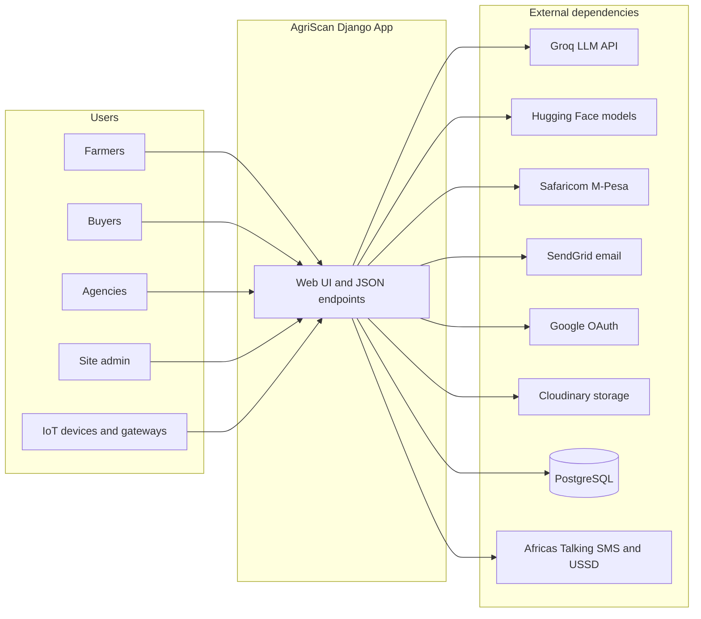
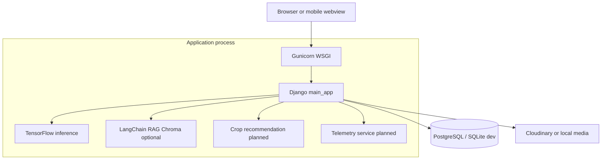
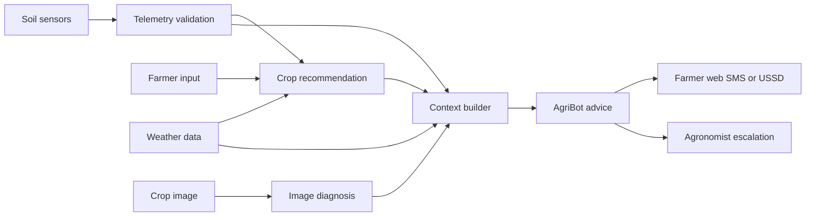

# AgriScan (crop_AI_analyzer) — System Documentation

This document describes the **AgriScan** platform in `crop_AI_analyzer`, including its deployed core and the approved integration design for crop recommendation and IoT field monitoring. It is the canonical system-level view. Current production functionality is distinguished from planned functionality so that roadmap items are not mistaken for implemented features.

**Production:** Contabo VPS at [agriscan.co.ke](https://agriscan.co.ke)
**Document version:** 2.0 — 30 July 2026

---

## 1. Requirements Documentation

### 1.1 Purpose and scope

**In scope**

- Web application for role-based users: **Farmers**, **Buyers**, and **Agro-agencies** (fertiliser, pesticide, seed).
- **AI crop diagnosis**: upload leaf images, validate as plant imagery (gatekeeper), classify disease/health per selected crop using TensorFlow models.
- **AgriBot chat**: LLM-backed agricultural Q&A with optional RAG (ChromaDB + embeddings) and location-aware context.
- **Marketplace discovery**: farmers list produce; buyers and agencies browse listings (dashboard-driven).
- **Farm Health Score** (300–850) and **partner REST API** for consenting farmers, keyed by phone number.
- **Monetisation**: wallet balances, per-scan and per-chat charges, M-Pesa STK callbacks, optional agency subscriptions for product listings.
- **Authentication**: Django auth, django-allauth (including Google OAuth), password reset via email (SendGrid).
- **Crop recommendation (integration in progress)**: recommend among 22 crops from N, P, K, temperature, humidity, pH, and rainfall using a versioned GaussianNB model and scaler.
- **IoT field monitoring (planned prototype)**: ingest authenticated NPK and soil-moisture readings and expose quality-checked field context to recommendations and advice.
- **Inclusive access (planned)**: SMS and USSD for selected farmer journeys.
- **Discoverability (in progress)**: technical and content SEO for `agriscan.co.ke`.

**Out of scope (unless added explicitly)**

- Guarantees of medical/veterinary or regulatory compliance; outputs are advisory.
- Offline-first mobile inference (described as future in README; not guaranteed in this repo).
- Full OpenAPI/Swagger coverage for all HTML routes (most interfaces are server-rendered forms and JSON chat).
- Automatic agronomic decisions without farmer confirmation or escalation.
- Treating low-cost sensor data as laboratory-equivalent without calibration.

### 1.2 Functional requirements (summary)

| ID | Requirement |
|----|-------------|
| FR-01 | Users can register and sign in as farmer, buyer, or agency. |
| FR-02 | Authenticated farmers can submit crop images for diagnosis subject to rate limits and wallet rules. |
| FR-03 | Non-plant images are rejected before crop classification (gatekeeper). |
| FR-04 | Successful farmer scans are logged (`CropScanLog`) for scoring. |
| FR-05 | Authenticated users can use the chat endpoint with RAG when configured; responses are JSON. |
| FR-06 | Farm Health Score is derived from scans, health ratio, and completed market connections; profile view triggers recalculation. |
| FR-07 | Partners with a valid `PartnerAPIKey` can `GET` score data for farmers who opted in, by phone query parameter. |
| FR-08 | M-Pesa callbacks update transaction records and either wallet balance or agency subscription. |
| FR-09 | Farmers can request a crop recommendation from validated seven-feature input; each result records input source and model version. *(Planned integration)* |
| FR-10 | Registered devices can submit attributable, timestamped telemetry; invalid readings are rejected or quarantined. *(Planned)* |
| FR-11 | Authorised users can view recent plot readings and their quality state. *(Planned)* |
| FR-12 | AgriBot can use authorised crop, weather, sensor, and diagnosis context while identifying data provenance. *(Planned)* |
| FR-13 | Priority advice and account flows are accessible through SMS/USSD. *(Planned)* |

### 1.3 Non-functional requirements

| Area | Target / implementation |
|------|-------------------------|
| **Security** | CSRF on web forms; `@csrf_exempt` only on selected JSON/callback routes; HTTPS-oriented cookie flags when `DEBUG=False`; secrets from environment. |
| **Performance** | Inference is bounded by model load and hardware; chat uses external APIs (Groq) and vector retrieval when enabled. |
| **Availability** | Designed for container deployment (Gunicorn); database via PostgreSQL in production (`DATABASE_URL`). |
| **Rate limiting** | `django-ratelimit` on scan, chat, password reset (see §4). |
| **Privacy** | Lending API returns data only if `FarmHealthProfile.opt_in_for_lending` is true. |
| **Traceability** | Recommendations and sensor readings retain source, timestamps, quality state, and model/device identity. |
| **Safety** | Low-confidence, high-risk, and implausible-data cases must be escalated rather than presented as definitive advice. |
| **IoT security** | Each device uses revocable credentials; requests are authenticated, rate-limited, and replay-resistant. *(Target)* |

---

## 2. Architectural Design

### 2.1 System context

External actors and systems interact with the Django application as follows.

### 2.2 Container diagram

### 2.3 Major components and interactions

| Component | Responsibility |
|-----------|----------------|
| **`main_app/views.py`** | HTTP routing logic: scans, chat, dashboards, lending API, M-Pesa, auth flows. |
| **TensorFlow models** | Loaded lazily; crop-specific models; preprocessing with Keras applications. |
| **Gatekeeper** | `is_plant_image()` (EfficientNet-based check in views) filters non-plant uploads. |
| **`utils_scoring.py`** | Computes Farm Health Score and persists `FarmHealthProfile`. |
| **`utils_weather.py`** | Weather helpers for farmer profile context (when configured). |
| **`mpesa_utils.py`** | STK push initiation and related configuration. |
| **django-allauth** | Social login under `/accounts/`. |
| **Crop recommendation service** *(planned)* | Django service/API loading a trusted GaussianNB model and MinMaxScaler; validates seven ordered features and logs model version. |
| **IoT device registry and telemetry** *(planned)* | Maps devices to plots, authenticates uploads, validates readings, and stores raw plus quality metadata. |
| **Context builder** *(planned)* | Selects authorised, recent, quality-approved sensor/weather/recommendation context for AgriBot and diagnosis advice. |

### 2.4 Target integrated decision flow

Measured, farmer-entered, weather-derived, and estimated values must remain distinguishable throughout this flow.

Supplementary diagram assets (if maintained separately) are referenced in [AgriScan Technical Architecture Schematics.md](./AgriScan%20Technical%20Architecture%20Schematics.md); prefer **Mermaid** in version control for diagrams that must remain portable.

---

## 3. Technical and System Specifications

### 3.1 Data models and relationships

Core entities (see `main_app/models.py`):

| Model | Role |
|-------|------|
| `FarmerProfile` | 1:1 with `User`; county, products, phone. |
| `BuyerProfile` | 1:1 with `User`; contact fields. |
| `AgencyProfile` | 1:1 with `User`; agency type, listings context. |
| `AgencyProduct` | FK to agency; catalog items with optional image. |
| `CropScanLog` | Per-scan audit: crop, result string, confidence, timestamp. |
| `MarketConnection` | Farmer–buyer linkage with status (`Pending` / `Completed` / etc.). |
| `FarmHealthProfile` | 1:1 with farmer; score, risk tier, `opt_in_for_lending`, `last_calculated`. |
| `PartnerAPIKey` | Partner name, API key, `is_active`. |
| `Wallet` | Balance, `scan_count`, `chat_count` (1:1 with `User`; created by signal). |
| `AgrovetSubscription` | Agency subscription plan and expiry. |
| `MpesaTransaction` | STK audit trail and fulfillment linkage. |

**Signals**: Creating `FarmerProfile` creates `FarmHealthProfile`; creating `User` creates `Wallet`.

### 3.2 Planned data entities

Names may change during implementation; migrations are not yet present.

| Entity | Purpose |
|---|---|
| `FarmPlot` | Identifies a farmer-managed field/plot and basic crop/location metadata. |
| `IoTDevice` | Device identity, plot assignment, credential status, firmware, and last contact. |
| `SensorReading` | Metric, value, unit, timestamp, raw payload reference, and quality status. |
| `CropRecommendation` | Seven inputs, source per input, model/scaler version, output, and timestamp. |
| `AgronomyEscalation` | Records cases requiring human review and their resolution. |

### 3.3 Data flow — crop scan (high level)

1. POST to `process` with multipart image + crop selection.
2. Validate size (≤ 5 MB), MIME (`jpeg`/`png`/`webp`), extension.
3. Gatekeeper rejects non-plant images.
4. Wallet check: first two farmer scans free trial; otherwise KSh 20 balance required.
5. Model predicts class; result and confidence logged for farmers.
6. Temporary file removed after inference.

### 3.4 Crop recommendation integration

The source recommender is a standalone Flask application owned by Stephen Kingori. It loads `gaussian_nb_model.pkl` and `minmax_scaler.pkl` and predicts one of 22 crop labels.

The production Django integration must:

1. Accept N, P, K, temperature, humidity, pH, and rainfall in a fixed documented order and unit.
2. Validate types, plausible ranges, missing values, and freshness.
3. Track whether each value is measured, farmer-entered, weather-derived, or estimated.
4. Load only repository-controlled, checksummed model artefacts.
5. Return a recommendation with model version and limitations.
6. Persist inputs and outcome for regression testing and agronomic evaluation.
7. Avoid random rainfall estimation and avoid inventing missing sensor values.

The existing model's reported notebook accuracy is not evidence of Kenyan field performance. Local agronomist and outcome validation is required.

### 3.5 IoT telemetry design

Initial metrics are N, P, K, and soil moisture. pH, soil temperature, ambient temperature/humidity, and other sensors can be added after prototype validation.

**Target ingestion sequence**

1. Device or gateway authenticates with a unique revocable credential.
2. Payload includes device ID, plot ID, observed timestamp, metric, value, unit, and sequence/message ID.
3. API validates identity, assignment, schema, timestamp drift, duplicate message, unit, and plausible range.
4. Accepted readings and quality flags are stored; suspicious readings are quarantined and never silently fed to AI.
5. Dashboards expose freshness, trends, battery/connectivity status, and calibration state.

Bulk sensor procurement must wait until representative devices are compared with reference measurements.

### 3.6 Farm Health Score algorithm

Implemented in `calculate_farm_health_score()` (`utils_scoring.py`):

- **Base**: 300 points.
- **Engagement** (max +200): +10 per scan in last 180 days, capped at 200.
- **Crop health** (max +200): fraction of recent scans whose `result` contains `"healthy"` (case-insensitive), scaled × 200.
- **Market** (max +150): +50 per `MarketConnection` with `status='Completed'`, capped at 150.

**Risk tiers**: ≥700 Low; ≥500 Medium; else High.

Recalculation is invoked from the farmer profile view (`views.py`), so scores refresh when the farmer visits that page after activity.

### 3.7 API documentation

#### Partner lending API

| Item | Value |
|------|-------|
| **URL** | `/api/v1/lending/score/` |
| **Method** | `GET` |
| **Auth** | Header `Authorization: Bearer <PartnerAPIKey.api_key>` |
| **Query** | `phone` — must match `FarmerProfile.phone_number` |
| **Success 200** | JSON: `farmer_name`, `county`, `health_score`, `risk_tier`, `active_connections`, `total_scans` |
| **403** | Farmer has not opted in (`opt_in_for_lending` false) |
| **404** | Farmer not found |

**Note**: This route is marked `@csrf_exempt`; authentication relies on the bearer token and partner key lookup.

#### Chat API

| Item | Value |
|------|-------|
| **URL** | `/chat/` |
| **Method** | `POST` |
| **Body** | JSON `{"message": "<text>"}` |
| **Response** | JSON (assistant text and optional error/limit fields) |
| **Auth** | Session login required |

Scan endpoint is **not** a REST JSON API: it is form POST to `process` returning rendered HTML.

#### Planned crop recommendation API

Provisional contract; the route is not implemented until merged.

- `POST /api/v1/crop-recommendations/`
- Auth: farmer session or approved service credential.
- Body: seven named numeric features plus optional source/plot metadata.
- Response: recommendation, model version, input provenance, warnings, and record ID.
- Errors: `400` invalid/missing input, `422` implausible or unusable data, `503` model unavailable.

#### Planned IoT telemetry API

- `POST /api/v1/iot/readings/`
- Auth: device credential, not a farmer browser session.
- Supports idempotency through a unique device/message identifier.
- Returns accepted/quarantined status and validation errors.
- Device provisioning, credential rotation, and revocation remain admin-only operations.

### 3.8 Primary URL map (application routes)

| Path | Purpose |
|------|---------|
| `/` | Homepage |
| `/login`, `/logout`, `/signup/*` | Auth |
| `/page` | Farmer scan entry (redirects buyers/agencies to dashboards) |
| `/process` | Image upload / prediction |
| `/chat/` | AgriBot |
| `/profile/farmer/`, `/dashboard/buyer/`, `/dashboard/agency/` | Role dashboards |
| `/api/v1/lending/score/` | Partner score API |
| `/mpesa/topup/`, `/mpesa/callback/` | Payments |
| `/accounts/` | allauth (social login) |

### 3.9 Source code documentation

Complex logic (scoring, gatekeeper, wallet gating, M-Pesa parsing) lives in Python modules with selective docstrings and inline comments. Contributors should document non-obvious financial or ML assumptions next to the code they change.

---

## 4. Operational Documentation

### 4.1 Runtime and infrastructure

| Item | Notes |
|------|-------|
| **Python** | 3.10 (Dockerfile) |
| **WSGI server** | Gunicorn binding `0.0.0.0:$PORT` |
| **Database** | PostgreSQL via env or `DATABASE_URL`; local defaults in `settings.py` |
| **Static files** | WhiteNoise; `collectstatic` in container CMD |
| **Media** | Cloudinary when `CLOUDINARY_URL` set; else local `media/` |
| **Production host** | Contabo VPS |
| **Public domain** | `https://agriscan.co.ke` |
| **Reverse proxy/TLS** | Nginx with HTTPS on the VPS; configuration must be maintained in the deployment runbook |

### 4.2 Configuration (environment variables)

| Variable | Purpose |
|----------|---------|
| `SECRET_KEY` | Django secret |
| `DEBUG` | `True`/`False` string |
| `DATABASE_URL` | Production DB (overrides discrete DB_* vars) |
| `DB_NAME`, `DB_USER`, `DB_PASSWORD`, `DB_HOST`, `DB_PORT` | Fallback DB settings |
| `CLOUDINARY_URL` | Production media |
| `GROQ_API_KEY` | LLM |
| `HF_TOKEN` | Hugging Face |
| `GOOGLE_CLIENT_ID`, `GOOGLE_CLIENT_SECRET` | OAuth |
| `EMAIL_HOST_USER`, `SENDGRID_API_KEY`, `DEFAULT_FROM_EMAIL` | Email |
| `DJANGO_LOG_LEVEL` | Optional logging override |
| `OPENWEATHER_API_KEY` | Weather context where enabled |
| `MPESA_*` | Daraja credentials, shortcode/passkey, callback configuration |
| `SMS_USSD_*` | Selected provider credentials and channel identifiers *(planned)* |
| `IOT_DEVICE_SIGNING_SECRET` or per-device credential store | IoT request authentication *(planned; prefer per-device credentials)* |
| `CROP_RECOMMENDER_MODEL_PATH`, `CROP_RECOMMENDER_SCALER_PATH` | Trusted recommender artefacts *(planned)* |

### 4.3 Deployment procedure (Contabo)

1. Build and test the Docker image from the reviewed release revision.
2. Back up PostgreSQL and record the rollback image/revision.
3. Configure secrets on the host; do not store production values in Git.
4. Run migrations and `collectstatic`.
5. Start Gunicorn behind Nginx and verify HTTPS for `agriscan.co.ke`.
6. Run smoke tests for authentication, scan, chat, marketplace, and any changed integration.
7. Verify logs, health checks, M-Pesa callback reachability, and backup status.
8. Roll back application and migration according to the deployment runbook if acceptance checks fail.

The previous Railway configuration may remain useful as a reference, but Contabo is the current production environment.

### 4.4 Session and security toggles

- Session lifetime: **1800** seconds (30 minutes); `SESSION_EXPIRE_AT_BROWSER_CLOSE = True`.
- When `DEBUG=False`: `SESSION_COOKIE_SECURE`, `CSRF_COOKIE_SECURE`, `SECURE_SSL_REDIRECT` enabled.
- `CSRF_TRUSTED_ORIGINS` and `ALLOWED_HOSTS` must include `agriscan.co.ke` and only approved hosts.

---

## 5. Maintenance and Troubleshooting

### 5.1 Routine maintenance

| Task | Action |
|------|--------|
| **Dependencies** | Update `requirements.txt` in a controlled branch; test inference and migrations. |
| **Database** | `python manage.py migrate`; backup PostgreSQL per hosting provider policy. |
| **Static/media** | After UI changes, run `collectstatic` in deployment pipeline. |
| **Partner keys** | Manage `PartnerAPIKey` via Django admin or data migration; deactivate compromised keys (`is_active=False`). |

### 5.2 Common issues

| Symptom | Likely cause | Direction |
|---------|----------------|-----------|
| 401 on lending API | Missing/invalid Bearer token | Verify `PartnerAPIKey` row and header format |
| 403 “has not consented” | `opt_in_for_lending` false | Farmer must opt in via product logic / admin |
| Scan always rejects image | Gatekeeper or wrong MIME/extension | Use clear leaf photo; allowed types only |
| “Insufficient balance” | Wallet below thresholds | Top-up flow; check free-trial rules for farmers |
| Chat 429 | Rate limit | `django-ratelimit` — wait and retry |
| M-Pesa success but no wallet change | Callback payload or transaction lookup | Inspect `MpesaTransaction` by `checkout_request_id`; check logs |
| Recommendation differs after deploy | Model/scaler mismatch or feature-order change | Verify checksums, versions, and seven-feature regression fixtures |
| Sensor values jump or remain constant | Faulty calibration, placement, power, or device | Quarantine readings; inspect device; compare with reference measurement |
| Device receives 401/403 | Missing, revoked, or mismatched device credential | Verify registry assignment and rotate credential if required |

### 5.3 Backups and recovery

- **Database**: Use managed PostgreSQL snapshots or `pg_dump` on your schedule.
- **Secrets**: Rotate `SECRET_KEY` only with session invalidation plan; rotate API keys in Groq, SendGrid, M-Pesa, and partner keys independently.

---

## 6. Test Plans and Results

### 6.1 Intended test coverage

| Area | Scenarios |
|------|-----------|
| **Scoring** | Known scan logs and connections produce expected score bounds (300–850) and tiers. |
| **Lending API** | Valid key + opted-in farmer returns 200; wrong phone 404; no consent 403. |
| **Process** | File size/type rejection; rate limit returns user-visible error. |
| **M-Pesa callback** | Atomic update of transaction and wallet/subscription. |
| **Crop recommendation** | Known fixtures produce stable predictions; validation rejects bad ranges/units; model/scaler mismatch fails safely. |
| **IoT telemetry** | Auth, replay/idempotency, schema, ranges, stale timestamps, quarantine, and plot permissions. |
| **Contextual advice** | Only authorised and quality-approved readings are used; provenance and escalation appear in output. |
| **USSD/SMS** | Session state, malformed callbacks, retries, concise copy, opt-out, and low-balance behavior. |

### 6.2 Current state of automated tests

The Django app’s `main_app/tests.py` is a placeholder with no test cases. **Formal test results are not yet recorded in CI.** Before crop recommendation or IoT reaches production, add automated coverage for scoring, lending consent, payment idempotency, recommendation regression fixtures, telemetry authentication/validation, and advice-context permissions.

---

## 7. Documentation Formats and Repository Map

| Format | Use in this project |
|--------|---------------------|
| **Markdown** | `README.md`, this file, `docs/proposal.md`, `docs/AgriScan_Stakeholder_Overview.md`, architecture notes under `docs/`. |
| **Mermaid** | Recommended for architecture in Git (see §2). |
| **UML / PNG** | Optional; external hosted diagram URLs may expire. |
| **Inline code comments** | ML, payments, and scoring modules. |
| **README** | Installation, stack badges, high-level features. |

---

## Document control

| Version | Date | Notes |
|---------|------|-------|
| 1.0 | 2026-05-03 | Initial system document aligned to repository `crop_AI_analyzer`. |
| 2.0 | 2026-07-30 | Recorded Contabo/domain deployment; added crop recommendation, IoT, SMS/USSD, four-person ownership, and integration safeguards. |

*Maintainers: update §6 when automated tests land; mark planned routes as implemented only after their code, migrations, tests, and deployment are complete.*

### Primary contact

**Job Nyaribari**  
**Phone:** +254 758 503819 (0758503819)  
**Email:** [jobnyaribari808@gmail.com](mailto:jobnyaribari808@gmail.com)
