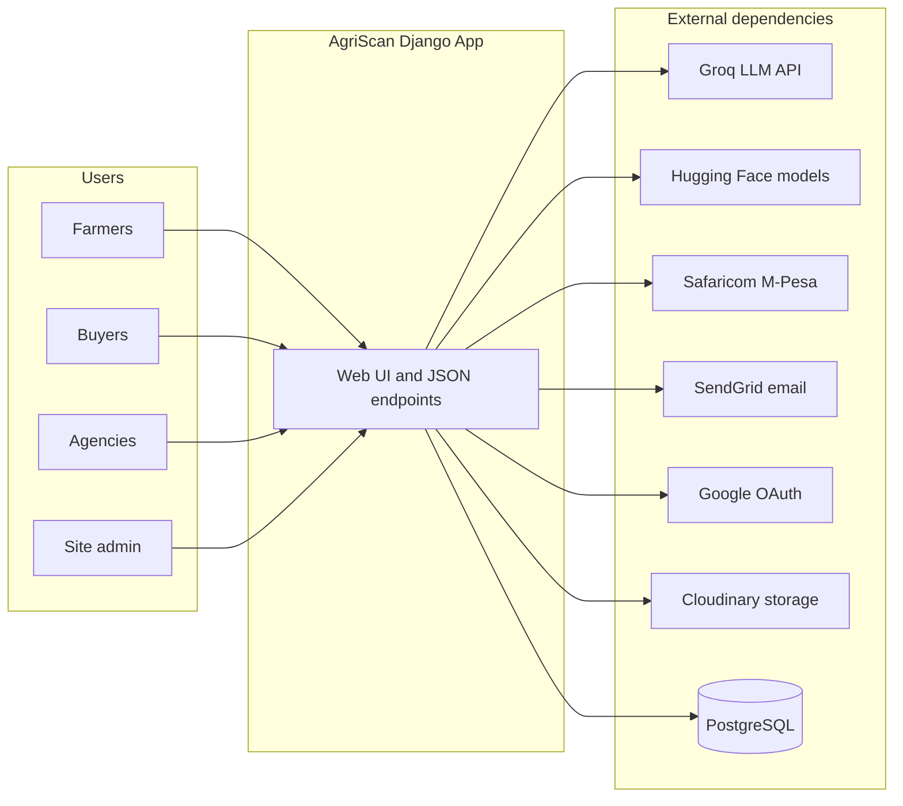
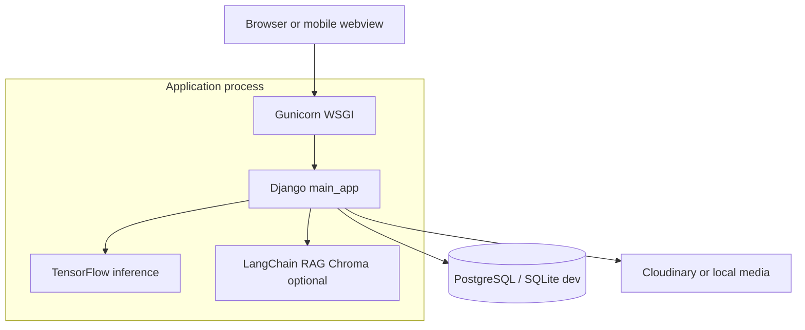

# AgriScan (crop_AI_analyzer) — System Documentation

This document describes the **AgriScan** platform in the repository `crop_AI_analyzer` using the standard documentation areas: requirements, architecture, technical specifications, operations, maintenance, and quality assurance. It is the canonical system-level view; feature-level detail also appears in [README.md](../README.md), [proposal.md](./proposal.md), and [AgriScan_Stakeholder_Overview.md](./AgriScan_Stakeholder_Overview.md).

---

## 1. Requirements Documentation

### 1.1 Purpose and scope

**In scope**

- Web application for role-based users: **Farmers**, **Buyers**, and **Agro-agencies** (fertiliser, pesticide, seed).
- **AI crop diagnosis**: upload leaf images, validate as plant imagery (gatekeeper), classify disease/health per selected crop using TensorFlow models.
- **AgriBot chat**: LLM-backed agricultural Q&A with optional RAG (ChromaDB + embeddings) and location-aware context.
- **Marketplace discovery**: farmers list produce; buyers and agencies browse listings (dashboard-driven).
- **Farm Health Score** (300–850) and **partner REST API** for consenting farmers, keyed by phone number.
- **Monetisation**: wallet balances, per-scan and per-chat charges, M-Pesa STK callbacks, optional agency subscriptions for product listings.
- **Authentication**: Django auth, django-allauth (including Google OAuth), password reset via email (SendGrid).

**Out of scope (unless added explicitly)**

- Guarantees of medical/veterinary or regulatory compliance; outputs are advisory.
- Offline-first mobile inference (described as future in README; not guaranteed in this repo).
- Full OpenAPI/Swagger coverage for all HTML routes (most interfaces are server-rendered forms and JSON chat).

### 1.2 Functional requirements (summary)

| ID | Requirement |
|----|-------------|
| FR-01 | Users can register and sign in as farmer, buyer, or agency. |
| FR-02 | Authenticated farmers can submit crop images for diagnosis subject to rate limits and wallet rules. |
| FR-03 | Non-plant images are rejected before crop classification (gatekeeper). |
| FR-04 | Successful farmer scans are logged (`CropScanLog`) for scoring. |
| FR-05 | Authenticated users can use the chat endpoint with RAG when configured; responses are JSON. |
| FR-06 | Farm Health Score is derived from scans, health ratio, and completed market connections; profile view triggers recalculation. |
| FR-07 | Partners with a valid `PartnerAPIKey` can `GET` score data for farmers who opted in, by phone query parameter. |
| FR-08 | M-Pesa callbacks update transaction records and either wallet balance or agency subscription. |

### 1.3 Non-functional requirements

| Area | Target / implementation |
|------|-------------------------|
| **Security** | CSRF on web forms; `@csrf_exempt` only on selected JSON/callback routes; HTTPS-oriented cookie flags when `DEBUG=False`; secrets from environment. |
| **Performance** | Inference is bounded by model load and hardware; chat uses external APIs (Groq) and vector retrieval when enabled. |
| **Availability** | Designed for container deployment (Gunicorn); database via PostgreSQL in production (`DATABASE_URL`). |
| **Rate limiting** | `django-ratelimit` on scan, chat, password reset (see §4). |
| **Privacy** | Lending API returns data only if `FarmHealthProfile.opt_in_for_lending` is true. |

---

## 2. Architectural Design

### 2.1 System context

External actors and systems interact with the Django application as follows.

### 2.2 Container diagram

### 2.3 Major components and interactions

| Component | Responsibility |
|-----------|----------------|
| **`main_app/views.py`** | HTTP routing logic: scans, chat, dashboards, lending API, M-Pesa, auth flows. |
| **TensorFlow models** | Loaded lazily; crop-specific models; preprocessing with Keras applications. |
| **Gatekeeper** | `is_plant_image()` (EfficientNet-based check in views) filters non-plant uploads. |
| **`utils_scoring.py`** | Computes Farm Health Score and persists `FarmHealthProfile`. |
| **`utils_weather.py`** | Weather helpers for farmer profile context (when configured). |
| **`mpesa_utils.py`** | STK push initiation and related configuration. |
| **django-allauth** | Social login under `/accounts/`. |

Supplementary diagram assets (if maintained separately) are referenced in [AgriScan Technical Architecture Schematics.md](./AgriScan%20Technical%20Architecture%20Schematics.md); prefer **Mermaid** in version control for diagrams that must remain portable.

---

## 3. Technical and System Specifications

### 3.1 Data models and relationships

Core entities (see `main_app/models.py`):

| Model | Role |
|-------|------|
| `FarmerProfile` | 1:1 with `User`; county, products, phone. |
| `BuyerProfile` | 1:1 with `User`; contact fields. |
| `AgencyProfile` | 1:1 with `User`; agency type, listings context. |
| `AgencyProduct` | FK to agency; catalog items with optional image. |
| `CropScanLog` | Per-scan audit: crop, result string, confidence, timestamp. |
| `MarketConnection` | Farmer–buyer linkage with status (`Pending` / `Completed` / etc.). |
| `FarmHealthProfile` | 1:1 with farmer; score, risk tier, `opt_in_for_lending`, `last_calculated`. |
| `PartnerAPIKey` | Partner name, API key, `is_active`. |
| `Wallet` | Balance, `scan_count`, `chat_count` (1:1 with `User`; created by signal). |
| `AgrovetSubscription` | Agency subscription plan and expiry. |
| `MpesaTransaction` | STK audit trail and fulfillment linkage. |

**Signals**: Creating `FarmerProfile` creates `FarmHealthProfile`; creating `User` creates `Wallet`.

### 3.2 Data flow — crop scan (high level)

1. POST to `process` with multipart image + crop selection.
2. Validate size (≤ 5 MB), MIME (`jpeg`/`png`/`webp`), extension.
3. Gatekeeper rejects non-plant images.
4. Wallet check: first two farmer scans free trial; otherwise KSh 20 balance required.
5. Model predicts class; result and confidence logged for farmers.
6. Temporary file removed after inference.

### 3.3 Farm Health Score algorithm

Implemented in `calculate_farm_health_score()` (`utils_scoring.py`):

- **Base**: 300 points.
- **Engagement** (max +200): +10 per scan in last 180 days, capped at 200.
- **Crop health** (max +200): fraction of recent scans whose `result` contains `"healthy"` (case-insensitive), scaled × 200.
- **Market** (max +150): +50 per `MarketConnection` with `status='Completed'`, capped at 150.

**Risk tiers**: ≥700 Low; ≥500 Medium; else High.

Recalculation is invoked from the farmer profile view (`views.py`), so scores refresh when the farmer visits that page after activity.

### 3.4 API documentation

#### Partner lending API

| Item | Value |
|------|-------|
| **URL** | `/api/v1/lending/score/` |
| **Method** | `GET` |
| **Auth** | Header `Authorization: Bearer <PartnerAPIKey.api_key>` |
| **Query** | `phone` — must match `FarmerProfile.phone_number` |
| **Success 200** | JSON: `farmer_name`, `county`, `health_score`, `risk_tier`, `active_connections`, `total_scans` |
| **403** | Farmer has not opted in (`opt_in_for_lending` false) |
| **404** | Farmer not found |

**Note**: This route is marked `@csrf_exempt`; authentication relies on the bearer token and partner key lookup.

#### Chat API

| Item | Value |
|------|-------|
| **URL** | `/chat/` |
| **Method** | `POST` |
| **Body** | JSON `{"message": "<text>"}` |
| **Response** | JSON (assistant text and optional error/limit fields) |
| **Auth** | Session login required |

Scan endpoint is **not** a REST JSON API: it is form POST to `process` returning rendered HTML.

### 3.5 Primary URL map (application routes)

| Path | Purpose |
|------|---------|
| `/` | Homepage |
| `/login`, `/logout`, `/signup/*` | Auth |
| `/page` | Farmer scan entry (redirects buyers/agencies to dashboards) |
| `/process` | Image upload / prediction |
| `/chat/` | AgriBot |
| `/profile/farmer/`, `/dashboard/buyer/`, `/dashboard/agency/` | Role dashboards |
| `/api/v1/lending/score/` | Partner score API |
| `/mpesa/topup/`, `/mpesa/callback/` | Payments |
| `/accounts/` | allauth (social login) |

### 3.6 Source code documentation

Complex logic (scoring, gatekeeper, wallet gating, M-Pesa parsing) lives in Python modules with selective docstrings and inline comments. Contributors should document non-obvious financial or ML assumptions next to the code they change.

---

## 4. Operational Documentation

### 4.1 Runtime and infrastructure

| Item | Notes |
|------|-------|
| **Python** | 3.10 (Dockerfile) |
| **WSGI server** | Gunicorn binding `0.0.0.0:$PORT` |
| **Database** | PostgreSQL via env or `DATABASE_URL`; local defaults in `settings.py` |
| **Static files** | WhiteNoise; `collectstatic` in container CMD |
| **Media** | Cloudinary when `CLOUDINARY_URL` set; else local `media/` |

### 4.2 Configuration (environment variables)

| Variable | Purpose |
|----------|---------|
| `SECRET_KEY` | Django secret |
| `DEBUG` | `True`/`False` string |
| `DATABASE_URL` | Production DB (overrides discrete DB_* vars) |
| `DB_NAME`, `DB_USER`, `DB_PASSWORD`, `DB_HOST`, `DB_PORT` | Fallback DB settings |
| `CLOUDINARY_URL` | Production media |
| `GROQ_API_KEY` | LLM |
| `HF_TOKEN` | Hugging Face |
| `GOOGLE_CLIENT_ID`, `GOOGLE_CLIENT_SECRET` | OAuth |
| `EMAIL_HOST_USER`, `SENDGRID_API_KEY`, `DEFAULT_FROM_EMAIL` | Email |
| `DJANGO_LOG_LEVEL` | Optional logging override |

### 4.3 Deployment procedure (Docker / Railway pattern)

1. Build image from `Dockerfile` (installs `requirements.txt`, copies project).
2. Set environment variables on the host (especially `SECRET_KEY`, `DATABASE_URL`, `CLOUDINARY_URL`).
3. Container runs: `migrate` → `collectstatic` → `gunicorn AgriProject.wsgi:application --bind 0.0.0.0:$PORT`.

See [README.md](../README.md) for clone-and-run developer setup.

### 4.4 Session and security toggles

- Session lifetime: **1800** seconds (30 minutes); `SESSION_EXPIRE_AT_BROWSER_CLOSE = True`.
- When `DEBUG=False`: `SESSION_COOKIE_SECURE`, `CSRF_COOKIE_SECURE`, `SECURE_SSL_REDIRECT` enabled.
- `CSRF_TRUSTED_ORIGINS` includes Railway hosts.

---

## 5. Maintenance and Troubleshooting

### 5.1 Routine maintenance

| Task | Action |
|------|--------|
| **Dependencies** | Update `requirements.txt` in a controlled branch; test inference and migrations. |
| **Database** | `python manage.py migrate`; backup PostgreSQL per hosting provider policy. |
| **Static/media** | After UI changes, run `collectstatic` in deployment pipeline. |
| **Partner keys** | Manage `PartnerAPIKey` via Django admin or data migration; deactivate compromised keys (`is_active=False`). |

### 5.2 Common issues

| Symptom | Likely cause | Direction |
|---------|----------------|-----------|
| 401 on lending API | Missing/invalid Bearer token | Verify `PartnerAPIKey` row and header format |
| 403 “has not consented” | `opt_in_for_lending` false | Farmer must opt in via product logic / admin |
| Scan always rejects image | Gatekeeper or wrong MIME/extension | Use clear leaf photo; allowed types only |
| “Insufficient balance” | Wallet below thresholds | Top-up flow; check free-trial rules for farmers |
| Chat 429 | Rate limit | `django-ratelimit` — wait and retry |
| M-Pesa success but no wallet change | Callback payload or transaction lookup | Inspect `MpesaTransaction` by `checkout_request_id`; check logs |

### 5.3 Backups and recovery

- **Database**: Use managed PostgreSQL snapshots or `pg_dump` on your schedule.
- **Secrets**: Rotate `SECRET_KEY` only with session invalidation plan; rotate API keys in Groq, SendGrid, M-Pesa, and partner keys independently.

---

## 6. Test Plans and Results

### 6.1 Intended test coverage

| Area | Scenarios |
|------|-----------|
| **Scoring** | Known scan logs and connections produce expected score bounds (300–850) and tiers. |
| **Lending API** | Valid key + opted-in farmer returns 200; wrong phone 404; no consent 403. |
| **Process** | File size/type rejection; rate limit returns user-visible error. |
| **M-Pesa callback** | Atomic update of transaction and wallet/subscription. |

### 6.2 Current state of automated tests

The Django app’s `main_app/tests.py` is a placeholder with no test cases. **Formal test results are not yet recorded in CI.** Adding `pytest`/`django.test` cases for `utils_scoring` and `farm_health_score_api` is the highest-value next step.

---

## 7. Documentation Formats and Repository Map

| Format | Use in this project |
|--------|---------------------|
| **Markdown** | `README.md`, this file, `docs/proposal.md`, `docs/AgriScan_Stakeholder_Overview.md`, architecture notes under `docs/`. |
| **Mermaid** | Recommended for architecture in Git (see §2). |
| **UML / PNG** | Optional; external hosted diagram URLs may expire. |
| **Inline code comments** | ML, payments, and scoring modules. |
| **README** | Installation, stack badges, high-level features. |

---

## Document control

| Version | Date | Notes |
|---------|------|-------|
| 1.0 | 2026-05-03 | Initial system document aligned to repository `crop_AI_analyzer`. |

*Maintainers: update §6 when automated tests land; update §3.4 if partner API contract changes.*

### Primary contact

**Job Nyaribari**  
**Phone:** +254 758 503819 (0758503819)  
**Email:** [jobnyaribari808@gmail.com](mailto:jobnyaribari808@gmail.com)
